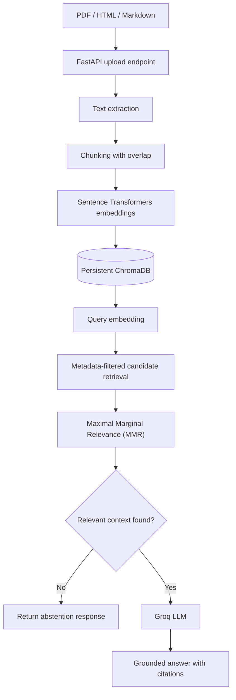

# Cost-Efficient RAG Application

A local-first Retrieval-Augmented Generation (RAG) application built for the SYN Labs Applied AI / ML Engineering take-home assignment. The service ingests PDF, HTML, and Markdown documents, stores embeddings in ChromaDB, retrieves relevant passages, and uses an LLM to generate answers grounded in document content with source citations.

The goal is to evaluate retrieval quality, answer quality, latency, and operating cost rather than relying on qualitative claims alone.

## 1. Architecture



### Technology choices

| Component | Implementation |
|---|---|
| Language | Python 3.12 |
| HTTP API | FastAPI |
| Vector store | ChromaDB with persistent local storage |
| Embeddings | `sentence-transformers/all-MiniLM-L6-v2` |
| Embedding dimension | 384 |
| Answer generation | Groq Chat Completions API |
| Default generation model | `openai/gpt-oss-20b` |
| Retrieval | Cosine similarity with MMR reranking |
| Evaluation | Python metrics, a fixed question set, and an LLM judge |

**Why ChromaDB?** It is an open-source vector store that can run on a single machine without requiring a dedicated managed vector-database service. That makes it suitable for prototypes, low-traffic applications, and workloads where operational simplicity and infrastructure cost matter.

## 2. Features

- **Document ingestion:** PDF, HTML, HTM, Markdown, and Markdown-extension files.
- **Configurable chunking:** 1,000-character chunks with 150-character overlap by default.
- **Duplicate prevention:** SHA-256 document identifiers prevent identical document versions from being indexed repeatedly.
- **Persistent storage:** Chunks, embeddings, and metadata are stored in a persistent ChromaDB collection.
- **Metadata filtering:** Retrieval can be restricted by metadata such as document source.
- **Diverse retrieval:** Maximal Marginal Relevance (MMR) balances query relevance with diversity among selected chunks.
- **Grounded answers:** The generation prompt asks the LLM to use retrieved context and cite the supporting sources.
- **Abstention:** When retrieval finds no sufficiently relevant context, the application returns a fixed fallback response rather than generating an unsupported answer.
- **Operational logging:** Query latency, retrieved chunk count, and token usage are recorded in query responses and application logs.
- **Evaluation outputs:** Retrieval metrics, answer-judge results, and cost estimates are saved as JSON and CSV files where applicable.

### Chunk metadata

Each stored chunk includes:

- `document_id`: SHA-256 hash of the source document.
- `source`: original filename.
- `file_type`: document extension.
- `page`: page number, where applicable.
- `chunk_index`: position of the chunk within the document.

The default embedding model and its 384-dimensional output are specified in the configuration and this README. If the embedding model or its dimensionality changes, the collection should be rebuilt using a consistent model.

## 3. Project structure

```text
Project 1/
├── app/
│   ├── __init__.py
│   ├── config.py
│   ├── embeddings.py
│   ├── ingestion.py
│   ├── main.py
│   ├── rag.py
│   └── store.py
├── evaluation/
│   ├── answer_results.json
│   ├── cost_analysis.py
│   ├── cost_comparison.csv
│   ├── cost_comparison.json
│   ├── evaluate_answers.py
│   ├── export_chunks.py
│   ├── it_operations.md
│   ├── questions.json
│   ├── retrieval_results.json
│   ├── run_evaluation.py
│   ├── sample_chunks.csv
│   ├── sample_handbook.md
│   └── sample_page.html
├── tests/
│   ├── test_ingestion.py
│   └── test_retrieval_metrics.py
├── .env.example
├── .gitignore
├── README.md
└── requirements.txt
```

The local ChromaDB database, uploaded documents, environment secrets, logs, and private test data are not intended to be committed to Git.

## 4. Requirements and setup

### Prerequisites

- Python 3.12 recommended.
- Internet access for dependency installation and the initial embedding-model download.
- A Groq API key for answer generation and LLM-judge evaluation.
- No GPU is required for the default embedding model.

From the project root, run:

```bash
python3 -m venv .venv
source .venv/bin/activate
python -m pip install --upgrade pip
pip install -r requirements.txt
cp .env.example .env
```

Add your own Groq API key to `.env`. Never commit `.env` or include API keys in source files, evaluation outputs, screenshots, or the README.

### Environment variables

| Variable | Default | Purpose |
|---|---|---|
| `GROQ_API_KEY` | No default secret | API authentication |
| `GROQ_MODEL` | `openai/gpt-oss-20b` | Answer-generation model |
| `JUDGE_MODEL` | `openai/gpt-oss-20b` | Evaluation-judge model |
| `EMBEDDING_MODEL` | `sentence-transformers/all-MiniLM-L6-v2` | Text embedding model |
| `CHROMA_DIR` | `data/chroma` | Persistent vector-store location |
| `CHUNK_SIZE` | `1000` | Target chunk size in characters |
| `CHUNK_OVERLAP` | `150` | Chunk overlap in characters |
| `DEFAULT_TOP_K` | `5` | Default number of returned chunks |
| `MMR_FETCH_K` | `20` | Candidate-pool size for retrieval and reranking |
| `MMR_LAMBDA` | `0.5` | Relevance/diversity balance for MMR |
| `MIN_RELEVANCE` | `0.25` | Minimum cosine-relevance score |
| `MAX_UPLOAD_MB` | `20` | Maximum file-upload size |

Environment variables are loaded by the application configuration. The actual API key must be supplied by the person running the project.

## 5. Run the application

Start the HTTP server from the project root:

```bash
python -m uvicorn app.main:app --host 127.0.0.1 --port 8000
```

The service listens at `http://127.0.0.1:8000`.

Interactive Swagger and ReDoc documentation routes are intentionally disabled. The application is accessed through HTTP endpoints and `curl` examples below.

If port 8000 is already occupied, stop the existing server with `Ctrl+C` in its terminal before starting another instance.

### Available endpoints

| Method | Endpoint | Purpose |
|---|---|---|
| `GET` | `/` | Basic service response |
| `POST` | `/documents/upload` | Upload and index documents |
| `POST` | `/query` | Ask a question about indexed content |
| `GET` | `/stats` | Inspect vector-store statistics |
| `GET` | `/documents` | List indexed document sources |

### Upload a document

For example, index the fictional evaluation handbook:

```bash
curl -X POST http://127.0.0.1:8000/documents/upload \
  -F 'files=@evaluation/sample_handbook.md'
```

Index the fictional IT operations policy as well:

```bash
curl -X POST http://127.0.0.1:8000/documents/upload \
  -F 'files=@evaluation/it_operations.md'
```

The endpoint returns ingestion information. Reuploading an identical document version should not add duplicate vectors.

### Query the corpus

```bash
curl -X POST http://127.0.0.1:8000/query \
  -H 'Content-Type: application/json' \
  -d '{
    "question": "Who must approve an employee system access request?",
    "top_k": 3
  }'
```

A successful response includes the answer, its supporting source chunks, the number of chunks retrieved, latency measurements, and token usage where returned by the model provider.

### Query using a metadata filter

```bash
curl -X POST http://127.0.0.1:8000/query \
  -H 'Content-Type: application/json' \
  -d '{
    "question": "How quickly must a Severity 1 incident be acknowledged?",
    "top_k": 3,
    "metadata_filter": {
      "source": {
        "$in": ["sample_handbook.md", "it_operations.md"]
      }
    }
  }'
```

### Verify no-context behavior

A query constrained to a nonexistent source should return the fallback answer with no source chunks:

```bash
curl -X POST http://127.0.0.1:8000/query \
  -H 'Content-Type: application/json' \
  -d '{
    "question": "What does this nonexistent document say?",
    "top_k": 3,
    "metadata_filter": {
      "source": "document_that_does_not_exist.md"
    }
  }'
```

This checks that a metadata filter yielding no results does not cause the application to invent an answer.

## 6. Evaluation

The evaluation suite uses 20 fixed questions based on the fictional documents `sample_handbook.md` and `it_operations.md`. The relevance labels and expected answers are defined in `evaluation/questions.json`.

The evaluation outputs are:

- `evaluation/sample_chunks.csv`: safe evaluation chunks used to map relevance labels to chunk IDs.
- `evaluation/retrieval_results.json`: per-question retrieval results and aggregate retrieval metrics.
- `evaluation/answer_results.json`: generated answers, judge evaluations, answer metrics, latency, and token usage.
- `evaluation/cost_comparison.json` and `evaluation/cost_comparison.csv`: estimated monthly costs at three vector scales.

### Run the automated tests

```bash
python -m pytest -v
```

The latest confirmed unit-test run passed all **19 tests**.

### Run retrieval evaluation

First ensure that the two fictional evaluation documents are indexed using the current chunking implementation. Then run:

```bash
python -m evaluation.export_chunks
python -m evaluation.run_evaluation
```

The evaluation computes Recall@k, Hit Rate@k, Mean Reciprocal Rank (MRR), nDCG@k, context precision, and retrieval latency statistics.

### Latest retrieval results

The latest recorded retrieval run after rebuilding the evaluation documents produced:

| Metric | Result |
|---|---:|
| Number of questions | 20 |
| `k` | 3 |
| Recall@3 | 1.0000 |
| Hit Rate@3 | 1.0000 |
| MRR | 0.9750 |
| nDCG@3 | 0.9775 |
| Context precision | 0.5833 |
| Retrieval latency p50 | 9.51 ms |
| Retrieval latency p95 | 377.02 ms |

All 20 questions retrieved at least one labeled relevant chunk in the top three. MRR below 1.0 indicates that not every first relevant result appeared at rank one. Context precision of 0.5833 also indicates that some retrieved chunks were not labeled relevant.

**Latency caveat:** The first request took approximately 7.27 seconds, likely because of cold-start/model initialization. The other requests were substantially faster. These measurements are based on only 20 queries on a development machine; the p50/p95 values should not be interpreted as production service-level guarantees. A more robust benchmark should include warm-up queries and repeated measurements.

### Run answer evaluation

After the final re-indexing and retrieval changes, rerun the answer evaluation:

```bash
python -m evaluation.evaluate_answers
```

This evaluates faithfulness/groundedness and answer relevance using an LLM judge. It also records exact match and token F1 against the reference answers, where applicable.

Use the latest `evaluation/answer_results.json` as the source of truth. Answer results created before the latest chunking and indexing changes should not be presented as the final answer-quality measurement.

The exact-match score can be zero when a correct generated response contains more words than a short reference answer. This is why the report should interpret EM alongside token F1 and judge-based faithfulness and relevance rather than treating EM alone as a quality score.

## 7. Cost comparison

The cost analysis estimates storage and monthly hosting costs at 100,000, 1 million, and 10 million vectors. It compares self-hosted ChromaDB on a DigitalOcean Droplet with managed DigitalOcean PostgreSQL using pgvector.

### Storage assumptions

For a 384-dimensional embedding:

- Embedding storage: `384 × 4 bytes = 1,536 bytes` per vector, assuming float32.
- Document-text payload: 1,024 bytes per vector.
- Metadata payload: 512 bytes per vector.
- Additional storage/index overhead: 1.5×.

The estimated size per vector is therefore:

`(1,536 + 1,024 + 512) × 1.5 = 4,608 bytes`

This corresponds to approximately 0.43 GiB for 100,000 vectors, 4.29 GiB for 1 million vectors, and 42.92 GiB for 10 million vectors.

These are planning estimates. Actual storage varies with text lengths, metadata size, index configuration, database overhead, and operational headroom.

### Monthly cost results

The following values are the current outputs from `evaluation/cost_analysis.py`. Hosting prices were checked against the provider's published pricing pages on October 18, 2026.

| Vector count | Estimated storage | Chroma hosting | Managed PostgreSQL + pgvector | Difference: managed minus Chroma |
|---:|---:|---:|---:|---:|
| 100K | 0.43 GiB | $12.00/month | $15.15/month | +$3.15/month |
| 1M | 4.29 GiB | $48.00/month | $30.45/month | -$17.55/month |
| 10M | 42.92 GiB | $252.00/month | $60.90/month | -$191.10/month |

Pricing references:

- [DigitalOcean Droplet pricing](https://www.digitalocean.com/pricing/droplets)
- [DigitalOcean Managed Databases pricing](https://www.digitalocean.com/pricing/managed-databases)

### Infrastructure assumptions

The self-hosted estimates use different Droplet sizes as the vector count increases:

- **100K vectors:** 2 GiB RAM, 1 vCPU, 50 GiB SSD; $12/month.
- **1M vectors:** 8 GiB RAM, 4 vCPUs, 160 GiB SSD; $48/month.
- **10M vectors:** 32 GiB RAM, 8 vCPUs, 100 GiB SSD; $252/month.

The managed PostgreSQL estimates use the provider's Standard single-node price tiers:

- **100K vectors:** 1 GiB RAM, with a 10–30 GiB storage range; $15.15/month.
- **1M vectors:** 2 GiB RAM, with a 30–60 GiB storage range; $30.45/month.
- **10M vectors:** 4 GiB RAM, with a 60–120 GiB storage range; $60.90/month.

The difference is calculated as managed PostgreSQL cost minus self-hosted Chroma hosting cost. A positive value favors the Chroma estimate; a negative value favors the managed PostgreSQL estimate.

These plans are **not performance-equivalent benchmarks**. They do not establish that every chosen instance can meet the same throughput or latency target. The estimates exclude LLM API charges, backups, high availability, replicas, additional storage, observability, taxes, and engineering time. Actual PostgreSQL capacity and vector-query performance must be benchmarked before adopting the cost estimates for production.

### Cost interpretation

In this scenario, self-hosted ChromaDB is slightly cheaper at 100K vectors. At 1M and 10M, the selected managed PostgreSQL plans have lower estimated monthly prices than the selected Chroma hosting instances.

This demonstrates that self-hosting is not automatically the cheapest option at every scale. Capacity requirements, query traffic, availability, operational overhead, and workload-specific benchmarks should guide the decision.

Run the cost analysis again with:

```bash
python -m evaluation.cost_analysis
```

## 8. Design trade-offs and limitations

### Retrieval versus generation

The current retrieval evaluation has perfect Recall@3 and Hit Rate@3, but context precision is 0.5833. This suggests that retrieving at least one useful chunk is working well on the fixed test set, while filtering out irrelevant context remains an area to improve.

The answer evaluation must be rerun against the final indexed corpus before making final claims about groundedness or relevance. LLM-judge metrics should be interpreted as estimates, not unquestionable ground truth.

### When to switch to a managed service

A managed vector or relational database may be preferable when the workload requires high availability, managed backups, predictable scaling, operational support, consistent latency, or multi-node capacity. It may also be more economical at some sizes, as shown by the estimates above.

Self-hosted ChromaDB is attractive when workload volume is modest, local or single-node deployment is acceptable, and the team is comfortable owning upgrades, backup/restore testing, monitoring, and recovery.

### Limitations

- The evaluation corpus contains two fictional documents and 20 questions; it does not represent every document type or production workload.
- Retrieval labels are manually specified, so metrics depend on the quality and completeness of those labels.
- Latency measurements come from a development machine and a small query sample.
- The LLM judge can be influenced by the same model family's preferences and is not a substitute for human review.
- Cost estimates are simplified and need workload-specific performance tests.
- The application does not provide production-grade authentication, multi-tenant isolation, high availability, or a distributed deployment configuration.

## 9. Privacy and repository hygiene

This project uses fictional evaluation documents so the evaluation can be shared without disclosing personal records.

Before submitting:

1. Keep `.env` and all real API keys out of Git.
2. Keep `data/`, which contains the local vector database and uploaded documents, out of Git.
3. Do not include private documents or their exported chunks in the evaluation corpus.
4. Keep only safe, fictional content in `evaluation/sample_chunks.csv`.
5. Check the staged files before committing.

Use:

```bash
git status --short --untracked-files=all
git check-ignore -v .env data/chroma data/uploads evaluation/chunks.csv
```

The `.env.example` file can be committed because it contains placeholders and configuration defaults, not secrets.

## 10. Final verification checklist

Before submitting the repository:

- [ ] Install dependencies in a fresh virtual environment.
- [ ] Run `python -m pytest -v` and verify the test results.
- [ ] Verify PDF, HTML, and Markdown ingestion through the HTTP endpoint.
- [ ] Reupload a document and verify that no duplicate vectors are added.
- [ ] Verify metadata-filtered retrieval and the no-context fallback.
- [ ] Regenerate `evaluation/sample_chunks.csv` and `evaluation/retrieval_results.json`.
- [ ] Regenerate `evaluation/answer_results.json` after the final re-index.
- [ ] Regenerate the cost comparison and confirm its assumptions.
- [ ] Verify that `.env`, `data/`, and private documents are not staged.
- [ ] Commit the final code and evaluation results with clear Git history.

The final evaluation artifacts, code, and documented assumptions should be consistent with the exact version of the application submitted.