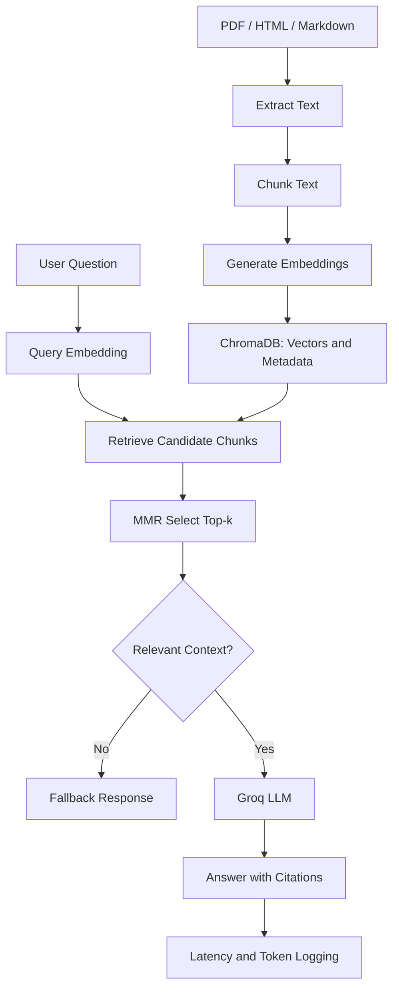

# Cost-Efficient RAG Application

A document question-answering application built with Python, FastAPI and ChromaDB. Users can upload PDF, HTML and Markdown files and ask questions about their contents.

## Features

- PDF, HTML and Markdown ingestion
- Configurable text chunking and overlap
- Local vector storage with ChromaDB
- Sentence Transformers embeddings
- Maximal Marginal Relevance (MMR) retrieval
- Metadata filtering and source citations
- Groq-based answer generation
- Duplicate-upload prevention
- No-context fallback
- Query latency, retrieved chunk count and token usage
- Retrieval and answer evaluation scripts
- Vector database cost comparison

## Technology Stack

- Python 3.12
- FastAPI
- ChromaDB
- Sentence Transformers
- Groq API
- PyPDF
- BeautifulSoup
- Pytest

## Architecture



## Configuration

Create a `.env` file from `.env.example`.

Configure these variables:

- `GROQ_API_KEY`: API key for answer generation
- `GROQ_MODEL`: Generation model
- `JUDGE_MODEL`: Answer-evaluation model
- `EMBEDDING_MODEL`: Sentence Transformers model
- `CHROMA_DIR`: Local vector database directory
- `CHUNK_SIZE`: Default 1000 characters
- `CHUNK_OVERLAP`: Default 150 characters
- `DEFAULT_TOP_K`: Default 5
- `MMR_FETCH_K`: Candidate pool size, default 20
- `MMR_LAMBDA`: Relevance-diversity balance, default 0.5
- `MIN_RELEVANCE`: Initial relevance threshold
- `MAX_UPLOAD_MB`: Maximum upload size, default 20 MB

Never commit `.env` or any real API key.

## Installation

Use Python 3.12.

```bash
python3.12 -m venv .venv
source .venv/bin/activate

python -m pip install --upgrade pip
pip install -r requirements.txt

cp .env.example .env
```

Add your API key to `.env`.

## Run the API

```bash
python -m uvicorn app.main:app --reload
```

The API runs locally at `http://127.0.0.1:8000`.

Swagger and the automatic API documentation routes are disabled.

## Upload Documents

Upload each document through the HTTP endpoint.

```bash
curl -X POST http://127.0.0.1:8000/documents/upload \
  -F "file=@evaluation/sample_handbook.md"
```

For an HTML file:

```bash
curl -X POST http://127.0.0.1:8000/documents/upload \
  -F "file=@evaluation/sample_page.html"
```

PDF files can be uploaded using the same endpoint.

## Query the Documents

```bash
curl -X POST http://127.0.0.1:8000/query \
  -H "Content-Type: application/json" \
  -d '{
    "question": "What is the leave policy?",
    "top_k": 3,
    "metadata_filter": null
  }'
```

The response includes an answer, source citations, retrieved chunk count, latency and token usage.

## Other Endpoints

- `GET /`: Health check
- `GET /stats`: Vector count
- `GET /documents`: Indexed documents
- `POST /documents/upload`: Upload and index a document
- `POST /query`: Ask a question

## Evaluation

Run the automated tests:

```bash
python -m pytest -v
```

Export the evaluation corpus after uploading the fictional sample documents:

```bash
python -m evaluation.export_chunks
```

Calculate retrieval metrics:

```bash
python -m evaluation.run_evaluation
```

Evaluate answer quality:

```bash
python -m evaluation.evaluate_answers
```

Run the vector database cost comparison:

```bash
python -m evaluation.cost_analysis
```

The evaluation scripts produce JSON and CSV reports in the `evaluation` directory.

The retrieval evaluation uses a fixed set of 20 questions and labeled relevant text. Answer evaluation records faithfulness, relevance, EM/F1, latency and token usage. The cost script produces estimates from its declared resource and storage assumptions.

## Design Decisions and Trade-offs

ChromaDB was selected for local persistent vector storage without requiring a dedicated managed vector database. Sentence Transformers provides local 384-dimensional embeddings, while MMR aims to balance query relevance with chunk diversity.

A lightweight local store reduces infrastructure requirements, but its performance depends on available CPU, memory, disk and index size. A managed database may be preferable when high availability, replication, operational support or predictable performance is required.

The cost comparison is an estimate based on declared assumptions. It does not establish that local ChromaDB is cheaper at every scale.

## Known Limitations

- Scanned PDFs may require OCR.
- The relevance threshold requires calibration against the test corpus.
- LLM-judge scores require validation and can be affected by model bias.
- Vector storage and latency estimates must be verified for the intended workload.

## Privacy

Local documents, the ChromaDB directory, generated logs, secrets and personal data must not be included in the submitted repository.

Only fictional evaluation documents and reproducible evaluation artifacts should be shared.
